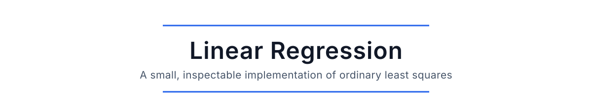

# Linear Regression

A compact NumPy implementation of ordinary least squares and L2-regularized linear regression. The code is intentionally small enough to inspect in one sitting.

## Features

- Closed-form fitting with a pseudoinverse
- Optional intercept
- Optional L2 regularization
- Single-output and multi-output targets
- Prediction and coefficient-of-determination scoring
- Input validation and unit tests

## Install

```bash
python -m venv .venv
source .venv/bin/activate
pip install -e .
```

## Example

```python
import numpy as np
from linear_regression import LinearRegression

X = np.arange(10, dtype=float).reshape(-1, 1)
y = 3.0 * X[:, 0] + 2.0

model = LinearRegression().fit(X, y)
print(model.coef_, model.intercept_)
```

## Test

```bash
python -m unittest -v
```

## Scope

The project favors clarity over scale. It does not include sparse solvers, online updates, statistical inference, or production data pipelines.
